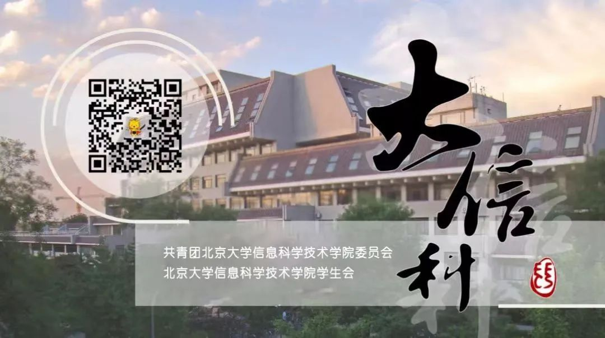

# 听众报名丨Frontier Electronics Technology Talk（FET²）

> 2025 年活动资料归档。下列时间、地点、报名二维码和奖项均属于 2025 年，不作为 2026 年活动信息使用。

北京大学电子信息科学类实验班主办的电子信息技术学术论坛 Frontier Electronics Technology Talk（FET²）将于 2025 年 11 月 22 日（星期六）举行，现面向信息科学技术学院、电子学院和集成电路学院开放观众报名通道，欢迎各位同学前来参加。

## 活动信息

- **时间：**2025 年 11 月 22 日（星期六）9:00—17:00，含午餐。
- **地点：**科学报告厅（中关新园 1 号楼 2 层）。

## 会议流程

### 上午场

上午设有主旨分享（Keynotes）和口头报告（Orals）。受邀老师先进行主旨分享，中途安排茶歇，随后由学生讲者分享。每位讲者报告 12 分钟，提问交流 3 分钟。

### 下午场

下午同样设有主旨分享和口头报告，中途安排茶歇及海报展示（Posters）交流。观众可将分发的贴纸贴在喜欢的海报上，最终依据贴纸数量评选海报奖项。

## 奖项设置

| 类别 | 奖项 | 奖金 | 名额 |
| --- | --- | ---: | ---: |
| 口头报告 | 一等奖 | 3000 元 | 1 位 |
| 口头报告 | 二等奖 | 2000 元 | 1 位 |
| 口头报告 | 三等奖 | 1000 元 | 2 位 |
| 海报展示 | 一等奖 | 2000 元 | 1 位 |
| 海报展示 | 二等奖 | 1000 元 | 1 位 |

所有参与海报展示或口头报告的同学将获得优秀奖及奖金 500 元。评奖结合评委打分和观众投票，具体细则以现场手册为准。

论坛设有抽奖环节，听众有机会获得奖品；所有听众均有伴手礼一份。

## 观众报名

请于 **2025 年 11 月 21 日 12:00 前**扫描下方二维码报名。名额有限，本科生优先。

## 鸣谢与署名

感谢电子信息科学类实验班发展项目对本活动的支持。

文案：肖康毅、肖天尧、高贺研。

## 整理说明

原文中的“插图”占位文字未对应可下载图片，整理时省略。三张有链接的图片已保存于 `assets/`。
